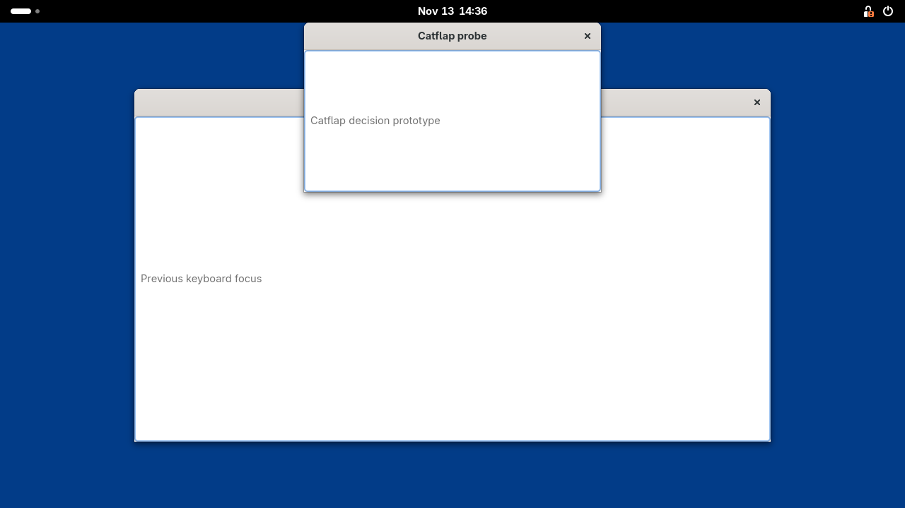
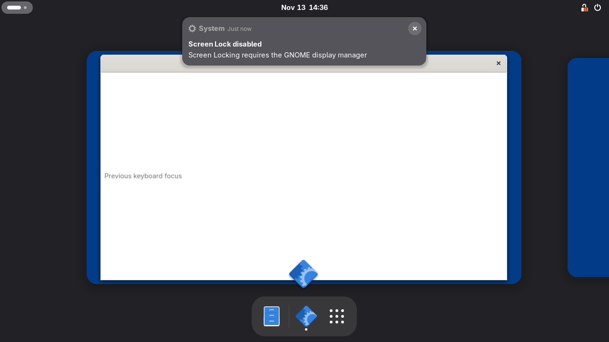
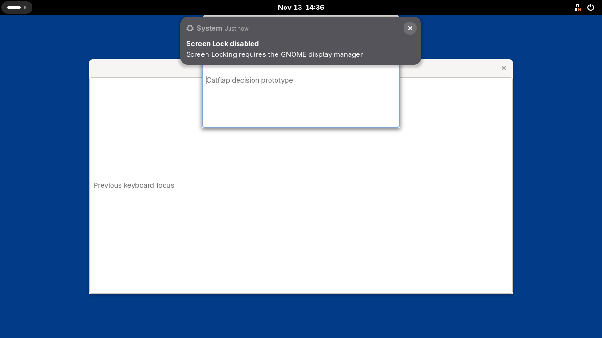

# GNOME extension decision

Decision id: T9. **The extension approach meets the seven prototype requirements
on GNOME Shell 51.1.** Keep the extension-managed GTK4 window approach. No
extension-drawn fallback was built. This is decision evidence, not production
GNOME support or a human interaction sign-off.

## Experiment

Question: can a Shell extension provide clipboard metadata, a registered shortcut,
a top-edge dwell trigger and placement/focus control for an external GTK4 window?
The falsifiable rule is seven PASS lines; any FAIL rejects this prototype.
The bounded fixture is one 1280×720 headless Wayland display, two GTK4 windows and
synthetic clipboard data. Files are isolated under `ci/gnome/` and `spikes/gnome/`;
no agent feature or fallback is implemented. The container runs GNOME Shell 51.1
and Swift 6.2.1 (`swift-6.2.1-RELEASE`, x86_64 Linux).

Reproduce:

```sh
ci/gnome/run.sh gnome-shell --version
ci/gnome/run.sh swift --version
ci/gnome/run.sh spikes/gnome/check.sh
```

The first commands print `GNOME Shell 51.1` and `Swift version 6.2.1
(swift-6.2.1-RELEASE)`. The last command exits 0 and prints:

```text
PASS extension loads and enables
PASS clipboard change reports offered types within 1 s
PASS marked clipboard item is never read
PASS GTK4 placement above windows, absent from overview and Alt+Tab
PASS show without focus and focus on request
PASS pointer dwell on top band
PASS registered shortcut reported
```

## Requirement ledger

Each row is exercised by `ci/gnome/run.sh spikes/gnome/check.sh`. The named
function in `spikes/gnome/check.py` identifies the exact assertion.

| Requirement | Result | Observation / command assertion |
| --- | --- | --- |
| Extension loads and enables | Met | Check 0: enabled state and Shell extension-manager state 1, not merely an exported object. |
| Clipboard change with offered types within 1 s | Met | `ordinary()`: independent GTK provider; the full raw type list contains `text/plain;charset=utf-8`; measured notification plus driver latency 21.25 ms. It then reads exactly once through the instrumented transfer API; length 25 and SHA-256 match the independent fixture. |
| No extension content read from a marked offer | Met | `marked()`: tests raw offers with `x-kde-passwordManagerHint` first and after the text type. In both cases the read count stays at 1 after the positive ordinary read, the marked clip has neither length nor hash, and provider request lists match the observer-blocked control. |
| GTK4 window top-centre, above, omitted from overview and Alt+Tab | Met | `placement()`: frame x=430, y=32, width=420 on width 1280; work area starts at y=32; above, sticky and skip-taskbar true; absent from compositor normal tab list; actual overview clones contain only the other GTK window. |
| Show without focus, focus on request | Met | `focus()`: focus remains on `Other GTK4 window` after mapping; explicit `Meta.Window.activate()` makes the probe's `has_focus()` true. |
| Top-band pointer dwell reported | Met | `dwell()`: timestamped virtual pointer motion to (640,1), held beyond 200 ms, increments the extension callback count (231.58 ms observed). |
| Registered shortcut reported | Met | `shortcut()`: real Ctrl+Alt+Space key events through a virtual keyboard trigger `accelerator-activated` for the registered action. It does not directly invoke the callback. |

Machine-readable observations: [results.json](../../spikes/gnome/evidence/results.json).
That file and the screenshots are regenerated by the check; the table records the
local decision run. Timing and action identifiers may differ on subsequent runs.

## Screenshots from the live session

Hover-style map, directly below the Shell top bar and above the other window:



The actual overview contains the other GTK window but no Catflap clone:



After an explicit focus request:



## Mechanism and limits

The client creates an ordinary GTK4 toplevel. The extension changes its compositor
window type to DOCK, calls `hide_from_window_list()`, `make_above()`, `stick()` and
`move_frame()`. Initial mapping does not activate it. This does not draw a second
panel implementation inside Shell. Production matching must use authenticated
agent/window identity, not this fixture's title.

The clipboard result is specifically about **extension** reads. GNOME's own
clipboard persistence requests text even with the observer blocked; the extension
cannot promise the compositor never reads marked data. The probe reads an unmarked text offer exactly once through its instrumented
`transfer_async()` into a resizable memory stream with a 4 MiB transfer ceiling.
It records only byte count and SHA-256, and the independent GTK client verifies
both against its fixture bytes. The observed length is 25 and SHA-256 is
`c4a7a9db849021a5bfc69ef47abbf52d684971026d8e8e1313d3db9ed4d311e9`.
Payload bytes are not retained in the clip record or written to `results.json`.

For marked offers, the whole raw type list is inspected before selecting text.
Two actual offered orders were tested: marker then text, and text then marker.
Both leave the read count unchanged at 1 and produce marked records with no
length or hash. Each provider receives the same system request list when the
observer is active and blocked. The ordinary positive read makes this skip test
non-vacuous: ignoring the marker would increment the counter and fail it.
Allowed-payload forwarding to an agent, production size-limit handling, Copy and
the control-channel connection remain T14 work.

The test extension intentionally enables Shell Eval and exposes virtual input for
unattended observation. Do not install it in a real user's session or promote it
unchanged. Polling the pointer is adequate for this fixture, not idle-CPU evidence.
Only Shell 51 is declared; only Shell 51.1 was run. Real-desktop interaction,
multiple displays, full-screen behaviour, accessibility, restart/reconnect and
production agent integration are not tested here.

The Swift toolchain is the official 6.2.1 release archive, not Ubuntu's userland.
The container uses named, separate build volumes, initializes them as root and
then drops to the caller's uid/gid before touching repository files. Swift build,
test and run commands first build their own pinned libtailcat. The host's build
caches are never mounted into the container. Before starting Docker, `run.sh`
creates the host `.build/` and `build/` mount points as the caller so Docker
cannot leave root-owned placeholders in a fresh checkout.

A real `ci/gnome/run.sh swift build` completed (15.15 s reported by Swift on
the first successful package compilation, after native/dependency preparation).
A second invocation with the named caches warm completed in 8.12 s wall time,
including Shell startup; Swift reported 2.75 s. A post-run ownership scan
(`find . -not -user "$(id -un)" -print`) printed nothing. The image includes
`diffutils` for the native build's `cmp` check and the legacy libxml2 ABI needed
by the official Swift tools. These checks used the mounted package, not a
standalone hello-world.

After the ownership fix, a fresh copy made without `.build/` or `build/` ran
`ci/gnome/run.sh gnome-shell --version` successfully. The post-run
`find . -not -user "$(id -un)" -print` had no output, both new directories were
owned by the caller, and `touch .build/probe` succeeded without elevated rights.
No shared-checkout build directory was deleted for this test.

## CI evidence

The `gnome` job in `.github/workflows/gnome.yml` runs the two version checks and
all seven prototype assertions. `ci-try t9 --jobs=gnome` exited 0:

```text
run 43444590748 [GNOME]: completed success
  job gnome: completed success
```

[Green GNOME run](https://github.com/yigityazicilar/catflap/actions/runs/43444590748),
snapshot `24bedf613d131031ccfe152051dcbef04af560d4`. A separate read of the
completed run and its logs confirmed Shell 51.1, Swift 6.2.1 and all seven PASS
lines, including the strengthened ordinary-read/marked-skip assertions. The
unrelated linux and macos jobs were not judged for this task.

An earlier remote run, 43440294478, passed six checks but missed the pointer dwell.
The driver had supplied timestamp zero and used a fixed sleep. It now moves out
of the band first, injects timestamped motion, then waits up to two seconds for a
new callback. The extension's required 200 ms dwell threshold is unchanged;
no callback is invoked directly and no failing check is skipped. The final local
and remote runs both passed.
